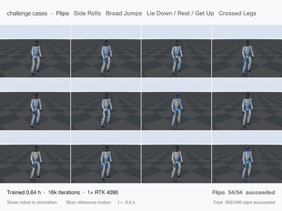

# allmimic: a SuperMimic re-implementation

<p align="center"></p>

An unofficial re-implementation of **SuperMimic** (Liao et al., *SuperMimic: Scaling Humanoid Whole-Body Control
with One Differentiable World Model*, arXiv 2610.28480) for the Unitree G1 in
[mjlab](https://github.com/mujocolab/mjlab) / MuJoCo Warp.

SuperMimic fits one MLP world model to replayed simulator transitions and trains a motion-tracking policy by
backpropagating through 32 imagined steps of that frozen model, with a small critic bootstrapping the tail of each
imagined rollout. The authors did not release code. This code started from
[dhmbb2/supermimic_vibe](https://github.com/dhmbb2/supermimic_vibe), a re-implementation of the paper.

## What is different

Compared with the paper and the original implementation:

- **Residual actions for the upper body, absolute actions for the legs.** The arms and torso track better as offsets
  from the reference, while leg targets tied to the reference fight balance.
- **A wider policy latent** (128 instead of 32), so the bottleneck between motion encoder and decoder does not limit
  tracking.
- **A share of the data is collected without exploration noise**, so the world model also sees the states a
  deterministic, deployed policy reaches. Otherwise the policy can exploit model errors there.
- **Per-joint world-model loss weights**, following D. Holden's
  ["Joint Error Propagation"](https://theorangeduck.com/page/joint-error-propagation): joints are weighted by how far
  their errors propagate to the tracked bodies.
- **A capped reset sampler and a policy gradient clip that takes effect.** Hard-example mining cannot pile onto a few
  unlearnable clips. The original clip never acted because the loss is divided by the horizon.
- **Balanced reset sampling.** The 1 s reset bins of the training data are clustered by reference kinematics and
  rare clusters start episodes more often: each cluster's share grows with size^0.3 instead of its size. Flips are
  0.04% of the BONES-SEED bins; without this, no flip is learned from the full training split.
- **A value clip.** Critic values used as targets and as the policy's bootstrap are clamped to the reachable range,
  ±(maximum step reward) / (1 − γ). Without it the critic eventually overestimates a few states, the policy follows
  the bootstrap there, and long runs diverge after 5 to 7 h. With it the critic loss stays flat.
- **Infeasible-clip filtering for BONES-SEED.** References a G1 cannot perform on a flat, empty floor, such as
  sitting on an invisible chair or leaning on a wall, are left out of training.
- **Compiled training steps with CUDA graphs** for the imagined rollout and the world-model loss, for faster
  training with unchanged gradients.

`--preset recommended` turns all of this on, except two data files: the infeasible-clip list and the bin clusters
for balanced sampling. Without the preset, every default is the original behavior. [CHANGES.md](CHANGES.md) lists every change, with its tests.

## Install

You need Linux, Python 3.11 and a CUDA GPU. We used RTX 4090 cards with CUDA 12.6.

```bash
python3.11 -m venv .venv && source .venv/bin/activate
pip install torch==2.14.1 --index-url https://download.pytorch.org/whl/cu126
pip install -r requirements.txt   # mjlab 1.2.0, mujoco 3.5.0, mujoco-warp 3.5.0, warp-lang 1.12.0, ...
export PYTHONPATH=$PWD            # all commands run from the repository root
pytest tests                      # CPU tests (no GPU needed); GPU checks are in tests/gpu/
```

## Data

No motion data is included. Check each dataset's license.

**LAFAN1.** Get the 40 G1 clips (`g1/*.csv`) of
[`lvhaidong/LAFAN1_Retargeting_Dataset`](https://huggingface.co/datasets/lvhaidong/LAFAN1_Retargeting_Dataset):

```bash
python scripts/prepare_motions.py --format lafan --fps-in 30 \
    --input data/raw/lafan1_g1/g1 --output data/processed/lafan1_50hz.npz
mkdir -p data/library_eval && cp data/processed/lafan1_50hz.npz data/library_eval/lafan1.npz
python tools/make_segments.py --lib data/library_eval/lafan1.npz --seconds 10   # 10 s segments for evaluation
```

**BONES-SEED.** Get `g1.tar.gz` and `seed_metadata_v004.csv` from the gated dataset
[`bones-studio/seed`](https://huggingface.co/datasets/bones-studio/seed):

```bash
mkdir -p data/raw/bones_seed && tar -xzf g1.tar.gz -C data/raw/bones_seed
CSV=data/raw/bones_seed/g1/csv
# the paper's Appendix-E filter (GPU; the full library needs ~40 GB of RAM)
python scripts/prepare_motions.py --format bones --fps-in 120 --workers 32 --input $CSV --output data/processed/bones_all.npz
python scripts/filter_bones.py --input data/processed/bones_all.npz --output data/processed/bones_filtered.npz \
    --report data/processed/bones_filter.json
# held-out splits: train, test_content (unseen motions), test_actor (unseen performers), test_random
python tools/make_bones_splits.py --metadata data/raw/bones_seed/seed_metadata_v004.csv \
    --kept data/processed/bones_filtered.npz --out-dir data/splits/bones_seed
# training library and infeasible-clip filter -> data/infeasible/bones_train_feasible.txt
python tools/build_allmimic_library.py --csv-dir $CSV --format bones --fps-in 120 \
    --clip-list data/splits/bones_seed/train.txt --out data/library/bones_train.npz
python tools/filter_infeasible.py features --lib data/library/bones_train.npz --out data/feats/bones_train.npz
python tools/filter_infeasible.py flag --feats data/feats/bones_train.npz --dataset bones_train
# bin clusters for balanced reset sampling (CPU) -> data/bin_clusters/bones_train.npz
python tools/bin_clusters.py --lib data/library/bones_train.npz --workers 16 --out data/bin_clusters/bones_train
# test libraries (full clips and 10 s segments), e.g. for test_content
python tools/build_allmimic_library.py --csv-dir $CSV --format bones --fps-in 120 \
    --clip-list data/splits/bones_seed/test_content.txt --out data/library_eval/bones_test_content.npz
python tools/make_segments.py --lib data/library_eval/bones_test_content.npz --seconds 10
```

**Hard motions.** [`lists/bones_hard.txt`](lists/bones_hard.txt) holds 306 BONES-SEED training clips from the hard
motion groups of the paper's failure table: flips (54), side rolls (22), broad jumps (24), crossed legs (10) and
lying / resting / standing up (196). [`lists/bones_hard.csv`](lists/bones_hard.csv) gives each clip's group.

```bash
python tools/build_allmimic_library.py --csv-dir $CSV --format bones --fps-in 120 \
    --clip-list lists/bones_hard.txt --out data/library_eval/bones_hard.npz
```

Other G1 retargets in the LAFAN1 CSV layout can be built as extra test sets with
`tools/build_allmimic_library.py --format lafan`.

## Train

```bash
# LAFAN1, one GPU
python -m allmimic.train --preset recommended --motions data/processed/lafan1_50hz.npz --out runs/lafan1

# BONES-SEED, 2 GPUs on one node: the reported run (batch sizes are per GPU; the learning rate scales with sqrt(GPUs))
torchrun --standalone --nproc_per_node=2 -m allmimic.train --preset recommended --motions data/library/bones_train.npz \
    --clip-list data/infeasible/bones_train_feasible.txt --bin-prior data/bin_clusters/bones_train.npz \
    --pi-batch 2048 --eval-every 0 --out runs/bones

# hard motions only, one GPU. In-run evaluation on all 306 clips every 4k iterations -> eval.jsonl
python -m allmimic.train --preset recommended --motions data/library_eval/bones_hard.npz --eval-every 4000 \
    --eval-clips 0 --out runs/bones_hard
```

A run writes `log.jsonl`, checkpoints (`ckpt_*.pt`, `last.pt`; resume with `--resume`) and, on LAFAN1, `eval.jsonl`
from the in-run evaluation. The CUDA-graph compilation was validated on RTX 4090. On other GPUs, run
`python tests/gpu/test_bptt_compile.py` first (its docstring has the command).

## Evaluate

Evaluation follows the paper's protocol: every clip plays once from its first frame, without randomization or
noise, with a deterministic policy. A clip fails on termination. The return is normalized by its maximum.

```bash
python -m allmimic.evaluate --run runs/lafan1                       # every checkpoint of a run, on LAFAN1
python tools/eval_allmimic.py --ckpt runs/bones/last.pt --out-dir runs/bones/eval \
    --testsets lafan1 lafan1_seg10 bones_test_content bones_test_content_seg10   # libraries in data/library_eval/
python tools/failure_report.py runs/bones/eval --testsets lafan1_seg10 bones_test_content_seg10
```

## Results

Training time is wall-clock hours of training on one RTX 4090 with `--preset recommended`, excluding evaluation.
Evaluation follows the protocol above.

| benchmark | result |
|---|---|
| LAFAN1 (40 clips, full length) | return 0.82 after 0.46 h; 0/40 failures after 0.60 h (return 0.89); return 0.93 after 1.3 h (0/40 failures) |
| BONES-SEED hard motions (306 clips, [list](lists/bones_hard.csv)), trained on these clips only | 0/306 failures after 0.46 h (return 0.83), flips 54/54, side rolls 22/22; return 0.91 after 1.5 h (0/306 failures) |
| BONES-SEED | TBD |

## Citation

Please cite the SuperMimic paper:

```bibtex
@article{liao2026supermimic,
  title   = {SuperMimic: Scaling Humanoid Whole-Body Control with One Differentiable World Model},
  author  = {Liao, Qiayuan and Shao, Yiyang and Long, Junfeng and Zakka, Kevin and Horowitz, Roberto and
             Abbeel, Pieter and Sreenath, Koushil},
  journal = {arXiv preprint arXiv:2610.28480},
  year    = {2026}
}
```

## Acknowledgements

- The method is by the SuperMimic authors.
- The base implementation is [dhmbb2/supermimic_vibe](https://github.com/dhmbb2/supermimic_vibe).
- The simulator is [mjlab](https://github.com/mujocolab/mjlab) on MuJoCo Warp, with the BeyondMimic tracking setup.
- The residual actions follow SuperTrack (Fussell et al., 2021).
- The world-model joint weights follow D. Holden's "Joint Error Propagation".
- Ideas taken from other open re-implementations are credited in [CHANGES.md](CHANGES.md).

## License

Not decided yet; see [LICENSE](LICENSE). The original implementation has no license file, so its terms must be
clarified first. The datasets are not included and keep their own licenses.
